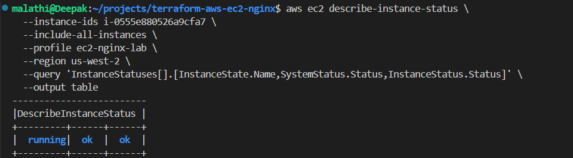
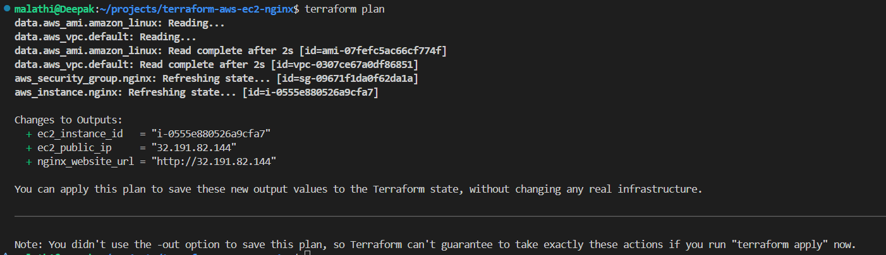
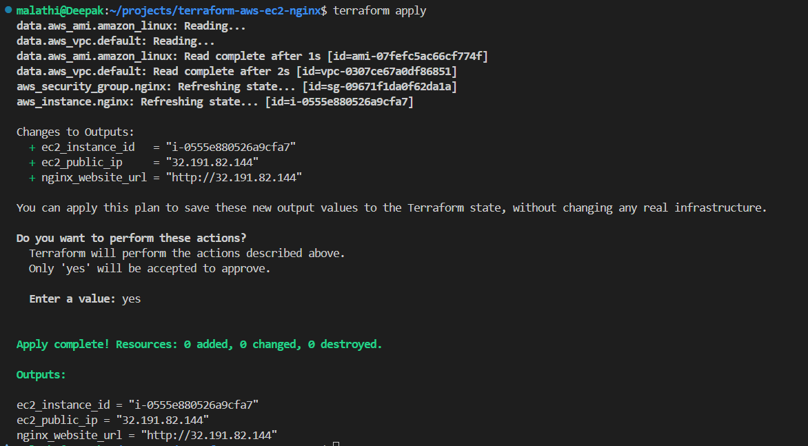
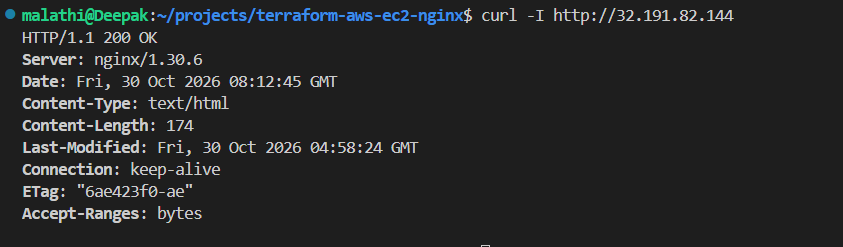
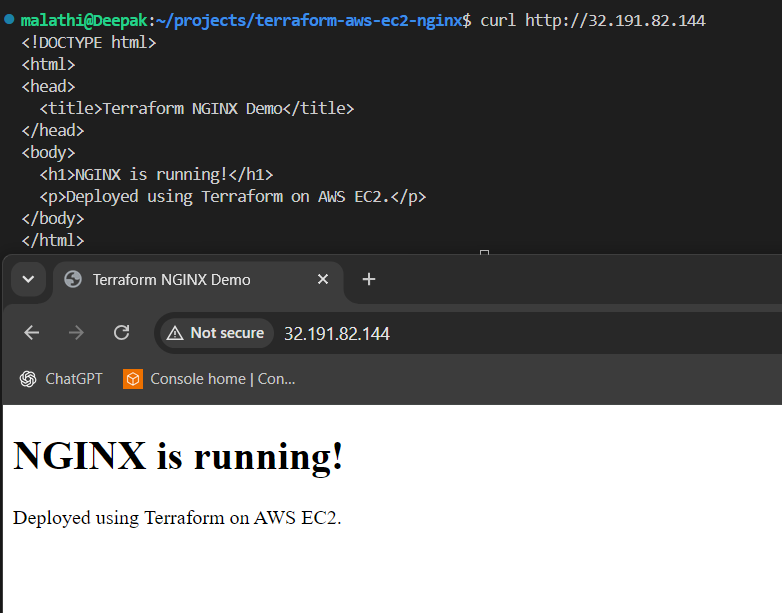
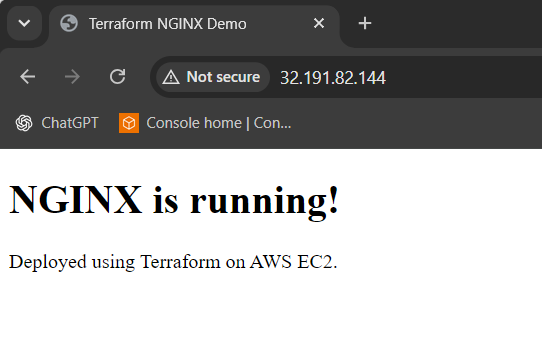
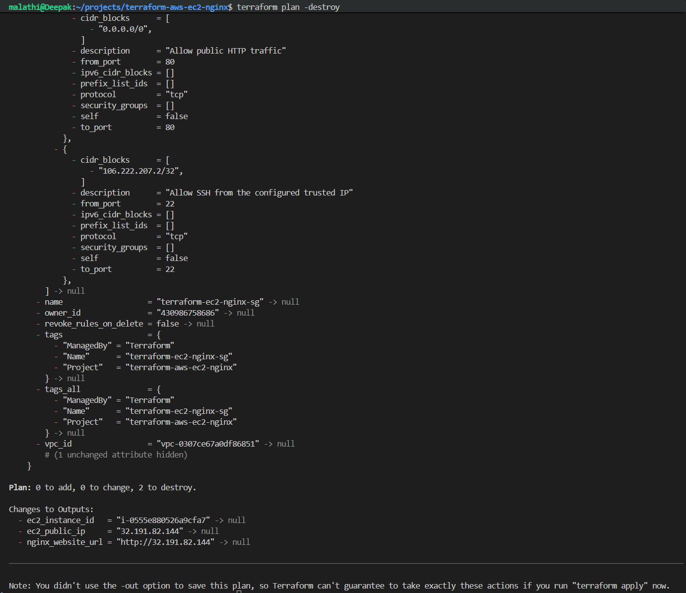
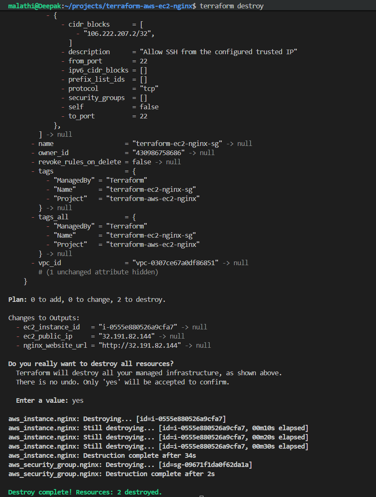
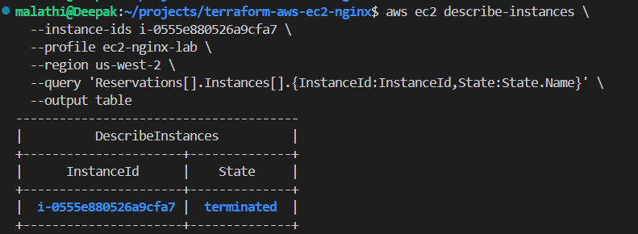
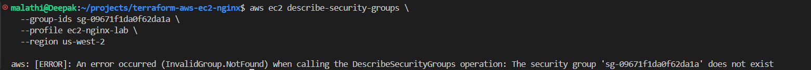

# AWS EC2 + NGINX Deployment Using Terraform

A beginner-friendly, hands-on Infrastructure as Code (IaC) project that provisions an AWS EC2 instance using Terraform, installs NGINX through EC2 user data, and hosts a custom HTML web page.

This project demonstrates how Terraform, AWS IAM, EC2, VPC networking, security groups, and NGINX work together to deploy a basic web application.

> **Project status: Successfully deployed, verified, and subsequently cleaned up.**
>
> Terraform successfully provisioned an EC2 instance and a dedicated security group.
>
> NGINX was installed and started through EC2 user data.
>
> The website returned `HTTP 200 OK`, and the custom HTML page was successfully retrieved.
>
> Terraform outputs were saved successfully.
>
> After deployment verification, the Terraform-managed EC2 instance and dedicated security group were destroyed successfully.
>
> **Previously tested website:** `http://32.191.82.144`
>
> **Note:** This public IP belonged to the completed deployment. The EC2 instance has since been terminated, so this is a historical reference and is no longer a live website endpoint.

---

## Contents

1. [Project Overview](#1-project-overview)
2. [Problem Statement](#2-problem-statement)
3. [Why Is This Project Needed?](#3-why-is-this-project-needed)
4. [When Can We Use This?](#4-when-can-we-use-this)
5. [Tools and Technologies](#5-tools-and-technologies)
6. [Prerequisites](#6-prerequisites)
7. [Project Structure](#7-project-structure)
8. [Step-by-Step Implementation](#8-step-by-step-implementation)
9. [Advantages and Disadvantages](#9-advantages-and-disadvantages)
10. [Current Progress](#10-current-progress)
11. [Conclusion](#11-conclusion)

---

## 1. Project Overview

This project demonstrates how to automate the provisioning of an AWS EC2 instance using Terraform and configure NGINX as a web server.

Instead of manually creating infrastructure through the AWS Management Console, Terraform allows us to define infrastructure in configuration files and manage it through code.

The project follows a step-by-step workflow:

1. Verify the local development environment.
2. Configure and verify AWS CLI authentication.
3. Inspect existing AWS resources before making changes.
4. Review IAM permissions required for discovery and deployment.
5. Configure the Terraform AWS provider.
6. Define an EC2 instance and dedicated security group.
7. Install and configure NGINX using EC2 user data.
8. Initialize, validate, plan, and apply Terraform configuration.
9. Verify the EC2 instance, NGINX service, and website.
10. Review Terraform outputs and deployment evidence.
11. Review the Terraform destroy plan.
12. Clean up the Terraform-managed resources and verify the cleanup.

### What did we deploy?

- An Amazon Linux 2023 EC2 instance.
- A dedicated security group for the project.
- SSH access restricted to a configured trusted IP address.
- HTTP access on port `80` for the public demo website.
- NGINX installed and started through EC2 user data.
- A custom HTML page served by NGINX.
- Terraform outputs for the instance ID, public IP, and website URL.

### Final deployment verification

| Verification | Observed result |
|---|---|
| EC2 instance | Running during deployment verification |
| System status check | `ok` |
| Instance status check | `ok` |
| NGINX | Installed and serving the website |
| HTTP response | `200 OK` |
| Custom HTML page | Retrieved successfully |
| Terraform outputs | Saved successfully |

### Final cleanup verification

| Verification | Observed result |
|---|---|
| Terraform destroy | Successful |
| Terraform-managed EC2 instance | Terminated |
| Dedicated project security group | Deleted |
| Terraform state | Empty after destroy |
| Existing default VPC and networking | Retained |
| Existing EC2 key pair | Retained |

---

## 2. Problem Statement

Creating AWS infrastructure manually through the AWS Management Console can take time and may lead to inconsistent configurations.

For example, when creating an EC2 instance manually, we need to configure:

- Amazon Machine Image (AMI)
- Instance type
- VPC and subnet
- Security group
- SSH access
- Storage
- Startup configuration
- Web server installation

Repeating these steps manually can become difficult when the same infrastructure needs to be recreated.

Terraform addresses this problem through Infrastructure as Code.

With Terraform, we define the required infrastructure in `.tf` files. Terraform communicates with AWS through its provider and creates or manages the resources according to the configuration.

This project uses Terraform to automate EC2 provisioning and NGINX deployment.

---

## 3. Why Is This Project Needed?

The main objectives are:

- Understand Infrastructure as Code using Terraform.
- Learn how Terraform communicates with AWS.
- Practise AWS EC2 provisioning.
- Understand AWS IAM users, groups, and policies.
- Learn how to identify missing AWS permissions.
- Understand VPCs, subnets, route tables, and Internet Gateways.
- Configure security groups with appropriate inbound rules.
- Automate software installation using EC2 user data.
- Deploy a basic website using NGINX.
- Understand Terraform initialization, formatting, validation, planning, applying, and state management.
- Practise troubleshooting using actual AWS and Terraform outputs.
- Understand how to review a Terraform destroy plan.
- Verify that Terraform-managed resources are cleaned up without deleting shared infrastructure.

The project also demonstrates an important DevOps practice:

**Verify the environment and permissions before creating infrastructure.**

---

## 4. When Can We Use This?

This approach is useful when:

- Creating repeatable development or testing environments.
- Automating virtual machine provisioning.
- Deploying a basic web server.
- Creating cloud infrastructure through version-controlled code.
- Reducing repetitive manual AWS Console operations.
- Learning Terraform and AWS integration.
- Building a foundation for larger cloud and DevOps projects.

The same approach can later be extended to:

- Application servers.
- Load balancers.
- Auto Scaling Groups.
- Private subnets.
- Databases.
- Multi-tier architectures.
- Monitoring and alerting.
- CI/CD-based infrastructure deployment.

---

## 5. Tools and Technologies

| Tool / Technology | Purpose |
|---|---|
| AWS | Cloud infrastructure |
| Amazon EC2 | Virtual server |
| Amazon Linux 2023 | Operating system |
| Terraform | Infrastructure as Code |
| AWS Provider | Allows Terraform to communicate with AWS |
| AWS CLI | AWS access and environment verification |
| AWS IAM | Identity and access management |
| VPC | Virtual network |
| Subnet | Network segment for the EC2 instance |
| Internet Gateway | Internet connectivity for the VPC |
| Security Groups | Instance-level network traffic control |
| NGINX | Web server |
| EC2 User Data | Startup automation |
| WSL Ubuntu | Local development environment |
| Git and GitHub | Version control and documentation |

---

## 6. Prerequisites

Before starting this project, make sure you have access to an AWS account and a local development environment where you can install and run Terraform and AWS CLI.

**Don't have Terraform or AWS CLI installed? No problem!** Follow the installation steps below before proceeding with the project.

### 6.1 Account and software requirements

| Requirement | Purpose | Required before starting? |
|---|---|---|
| AWS account | Provides access to AWS cloud services. | Yes |
| WSL Ubuntu / Linux / macOS / Windows environment | Provides a terminal to execute commands. | Yes |
| AWS CLI | Allows you to interact with AWS from the terminal. | Yes, install before AWS configuration |
| Terraform | Automates AWS infrastructure provisioning. | Yes, install before Terraform commands |
| AWS IAM user or role | Provides permissions to access and manage AWS resources. | Yes |
| Git | Helps manage and version-control the project. | Recommended |
| GitHub account | Allows you to store and share the project repository. | Optional for local execution |

### 6.2 Install the required tools

If Terraform or AWS CLI is not installed on your system, install them first.

#### A. Install AWS CLI

AWS CLI allows you to interact with AWS services from your terminal.

For Ubuntu / WSL Ubuntu, follow the official AWS installation instructions:

https://docs.aws.amazon.com/cli/latest/userguide/getting-started-install.html

After installation, verify it:

```bash
aws --version
```

Expected output format:

```text
aws-cli/2.x.x Python/3.x.x Linux/...
```

The exact version and additional details may differ.

#### B. Install Terraform

Terraform is used to define and provision AWS infrastructure through configuration files.

For Ubuntu / WSL Ubuntu, follow the official HashiCorp installation instructions:

https://developer.hashicorp.com/terraform/install

After installation, verify it:

```bash
terraform version
```

Expected output format:

```text
Terraform vX.Y.Z
```

The version may differ depending on when you install it.

#### C. Install Git (if not already installed)

Git is used for version control.

```bash
git --version
```

If Git is not installed on Ubuntu:

```bash
sudo apt update
sudo apt install git -y
```

Verify again:

```bash
git --version
```

### 6.3 Configure AWS CLI credentials

Once AWS CLI is installed, configure an AWS profile.

For this project, the profile used is:

```text
ec2-nginx-lab
```

Configure your own credentials using:

```bash
aws configure --profile ec2-nginx-lab
```

AWS CLI prompts for:

- AWS Access Key ID
- AWS Secret Access Key
- Default Region Name
- Default Output Format

For this project, the Region is:

```text
us-west-2
```

For output format, you can enter:

```text
json
```

**Security note:** Never share your access keys or commit AWS credentials to GitHub. For production environments, prefer IAM roles or another supported temporary credential mechanism instead of long-lived access keys.

### 6.4 Verify your environment before proceeding

After installation and configuration, verify that the required tools and AWS access are working.

#### Check Terraform

```bash
terraform version
```

#### Check AWS CLI

```bash
aws --version
```

#### Check the configured AWS profile

```bash
aws configure list --profile ec2-nginx-lab
```

#### Verify AWS authentication

```bash
aws sts get-caller-identity --profile ec2-nginx-lab
```

A successful response should return your AWS account ID, ARN, and user ID.

#### Verify the configured Region

```bash
aws configure get region --profile ec2-nginx-lab
```

Expected:

```text
us-west-2
```

### 6.5 AWS infrastructure and permission checks

Before provisioning infrastructure, inspect the AWS environment.

The following checks are part of this project's preparation and implementation process:

- [ ] An active AWS account.
- [ ] AWS CLI installed.
- Terraform installed.
- [ ] Verify that the AWS profile can authenticate.
- [ ] Confirm the AWS Region.
- [ ] Inspect existing VPC details.
- [ ] Inspect available subnets.
- [ ] Verify the Internet Gateway.
- [ ] Inspect the route table and internet route.
- [ ] Check EC2 instance type availability.
- [ ] Verify the existing EC2 key pair.
- [ ] Verify the local private key, if SSH access is required.
- [ ] Check the IAM permissions required for discovery and deployment.
- [ ] Prepare the Terraform configuration files.
- [ ] Configure `.gitignore`.

**Important:** The VPC, subnet, Internet Gateway, route table, and key pair do not need to be created again if suitable existing resources are available. This project reuses existing AWS networking and the existing key pair.


### Environment used in this project

| Item | Value |
|---|---|
| Local terminal | WSL Ubuntu |
| Project directory | `~/projects/terraform-aws-ec2-nginx` |
| Terraform version | `1.15.7` |
| AWS CLI version | `2.35.3` |
| AWS CLI profile | `ec2-nginx-lab` |
| AWS Region | `us-west-2` |
| Region name | US West (Oregon) |
| EC2 instance type | `t3.micro` |
| Operating system | Amazon Linux 2023 |
| Availability Zone | `us-west-2a` |
| Existing VPC | Default VPC |
| Existing key pair | `ec2-nginx-lab-key` |

**Important:** The AWS CLI profile is explicitly configured in the Terraform provider. Do not assume the default AWS CLI profile is the correct one for this project.


**Proceed to Section 7 only after the required tools are installed and AWS authentication is working.**


---

## 7. Project Structure

The project repository is organized as follows:

```text
terraform-aws-ec2-nginx/
│
├── README.md
├── .gitignore
├── .terraform.lock.hcl
│
├── versions.tf
├── main.tf
├── variables.tf
├── outputs.tf
│
└── screenshots/
    ├── 1-1-current-directory.png
    ├── 1-2-check-whether-terraform-is-installed.png
    ├── 1-3-check-whether-aws-cli-is-installed.png
    ├── 1-4-check-which-aws-region-your-cli-currently-uses.png
    ├── 1-5-inspect-the-credential-source-without-revealing-the-secret-key.png
    ├── 1-6-check-which-named-profiles-exist.png
    ├── 1-7-test-each-aws-profile.png
    ├── 1-8-verify-the-working-aws-profile.png
    ├── 1-9-verify-the-region.png
    ├── 2-1-check-aws-permissions-before-creating-resources.png
    ├── 2-2-check-existing-subnets.png
    ├── 2-3-check-the-internet-gateway.png
    ├── 2-4-check-the-default-route-table.png
    ├── 2-5-check-ec2-permissions-no-output.png
    ├── 2-6-check-security-group-permissions.png
    ├── 2-7-inspect-the-existing-security-group-rules.png
    ├── 2-8-check-ec2-key-pairs.png
    ├── 2-9-verify-the-local-private-key.png
    ├── 2-10-verify-the-ec2-instance-type-is-available.png
    ├── 2-11-check-whether-you-can-inspect-your-own-iam-permissions.png
    ├── 2-12-retest-instance-type-discovery.png
    ├── 2-13-verify-the-ec2-deployment-permissions.png
    ├── 2-14-verify-ec2-instance-creation-permissions.png
    ├── 2-15-identify-the-remaining-permission-gaps.png
    ├── 2-16-update-the-deployment-policy-add-ec2-createtags.png
    ├── 2-17-verify-the-aws-credentials.png
    ├── 3-1-configure-terraform-to-use-the-correct-aws-profile.png
    ├── 3-2-create-a-.gitignore-file.png
    ├── 4-13-remove-the-tainted-status-without-deleting-ec2.png
    ├── 4-14-remove-terraforms-tainted-status.png
    ├── 4-15-run-a-fresh-terraform-plan.png
    ├── 4-16-save-the-terraform-outputs.png
    ├── 4-17-test-your-nginx-website.png
    ├── 4-18-terraform-deployed-ec2-instance-is-successfully-serving-http-traffic.png
    ├── 4-19-terraform-nginx-live-website.png
    ├── 5-1-generate-the-destroy-plan.png
    ├── 5-2-execute-cleanup.png
    ├── 5-3-verify-terraform-state.png
    ├── 5-4-verify-ec2-instance.png
    └── 5-5-verify-security-group.png
```

**Note:** The screenshot directory also contains intermediate deployment evidence captured during the Terraform troubleshooting process. Keep the screenshot references synchronized with the actual filenames in your repository. The tree above lists the known screenshot references; it does not claim that every intermediate screenshot filename has been independently verified.

### Terraform file responsibilities

| File | Responsibility |
|---|---|
| `versions.tf` | Defines Terraform version requirements, AWS provider version, and provider configuration. |
| `main.tf` | Defines AWS data sources, the dedicated security group, and EC2 instance configuration, including user data. |
| `variables.tf` | Defines configurable input values such as the allowed SSH source CIDR. |
| `outputs.tf` | Exposes useful deployment information such as instance ID, public IP, and website URL. |
| `.terraform.lock.hcl` | Records the selected provider version and checksums. |
| `.gitignore` | Prevents local state, secrets, and generated files from being committed. |

**Implementation note:** NGINX startup configuration is embedded directly in the EC2 `user_data` configuration inside `main.tf`. A separate `user_data.sh` file is not used in the final implementation.

---

## 8. Step-by-Step Implementation

### Phase 1: Verify the Local Environment

Before working with AWS, verify that the required tools are installed and that the terminal is in the correct project directory.

#### Step 1.1: Check the current directory

```bash
pwd
```

This confirms the current working directory.


#### Step 1.2: Check Terraform installation

```bash
terraform version
```

Expected: Terraform version information should be displayed.


#### Step 1.3: Check AWS CLI installation

```bash
aws --version
```

Expected: AWS CLI version information should be displayed.


#### Step 1.4: Check the configured AWS Region

```bash
aws configure get region --profile ec2-nginx-lab
```

Expected:

```text
us-west-2
```


#### Step 1.5: Inspect the credential source safely

Check where AWS CLI obtains its credentials without printing the secret access key.

```bash
aws configure list --profile ec2-nginx-lab
```


#### Step 1.6: List available AWS CLI profiles

```bash
aws configure list-profiles
```


#### Step 1.7: Test AWS authentication

```bash
aws sts get-caller-identity --profile ec2-nginx-lab
```

This verifies whether the selected AWS profile can authenticate successfully.


#### Step 1.8: Verify the working profile

```bash
aws sts get-caller-identity --profile ec2-nginx-lab
```

The command successfully identified the lab IAM user.


#### Step 1.9: Verify the AWS Region again

```bash
aws configure get region --profile ec2-nginx-lab
```


**Result:** Terraform and AWS CLI were installed and verified. The `ec2-nginx-lab` profile successfully authenticated with AWS in `us-west-2`.

---

### Phase 2: Discover Existing AWS Resources and Verify IAM Permissions

Before creating infrastructure, inspect the existing AWS environment.

This is important because we do not want to create duplicate resources or accidentally modify shared network infrastructure.

#### Step 2.1: Check AWS permissions

Review the available permissions before creating resources.


#### Step 2.2: Inspect existing subnets

```bash
aws ec2 describe-subnets \
  --profile ec2-nginx-lab \
  --region us-west-2 \
  --query 'Subnets[].{SubnetId:SubnetId,AZ:AvailabilityZone,CIDR:CidrBlock,Default:DefaultForAz}' \
  --output table
```

This helps identify available subnets and their Availability Zones.


#### Step 2.3: Verify the Internet Gateway

```bash
aws ec2 describe-internet-gateways \
  --profile ec2-nginx-lab \
  --region us-west-2 \
  --query 'InternetGateways[].{GatewayId:InternetGatewayId,VPCs:Attachments[].VpcId}' \
  --output table
```

An Internet Gateway enables communication between a VPC and the internet when the associated routing and security rules allow it.


#### Step 2.4: Inspect the route table

```bash
aws ec2 describe-route-tables \
  --profile ec2-nginx-lab \
  --region us-west-2 \
  --query 'RouteTables[].{RouteTableId:RouteTableId,VPC:VpcId,Routes:Routes[].{Destination:DestinationCidrBlock,Gateway:GatewayId}}' \
  --output json
```

This helps verify whether the VPC has an internet route through an Internet Gateway.


#### Step 2.5: Check EC2 permissions

Verify whether the IAM identity can inspect the EC2 resources required for the project.


#### Step 2.6: Check security group permissions

Review the permissions available for security group operations.


#### Step 2.7: Inspect existing security groups

```bash
aws ec2 describe-security-groups \
  --profile ec2-nginx-lab \
  --region us-west-2 \
  --output table
```

The existing default security group was inspected. A separate security group was planned for the project rather than modifying the default security group.


#### Step 2.8: Check existing EC2 key pairs

```bash
aws ec2 describe-key-pairs \
  --profile ec2-nginx-lab \
  --region us-west-2 \
  --output table
```

The project reused the existing key pair:

```text
ec2-nginx-lab-key
```


#### Step 2.9: Verify the local private key

```bash
ls -l ~/.ssh/ec2-nginx-lab-key.pem
```

The private key must be available locally and protected with restrictive file permissions.


Never upload private keys to GitHub or include their contents in screenshots.

#### Step 2.10: Verify EC2 instance type availability

Check whether the intended EC2 instance type is offered in the selected Region and Availability Zone.


#### Step 2.11: Check IAM inspection permissions

Some IAM inspection operations may be restricted for a lab user. Check permissions without assuming the user can inspect every IAM setting.


#### Step 2.12: Retest instance type discovery

After updating the discovery permissions, retest instance type availability.


#### Step 2.13: Verify deployment permissions

Review the permissions required for EC2 deployment and security group configuration.


#### Step 2.14: Verify EC2 instance creation permissions

Check whether the IAM policy permits the required EC2 creation operations.


#### Step 2.15: Identify remaining permission gaps

During discovery and deployment, some AWS API calls returned authorization errors.

Instead of granting broad `ec2:*` access, the missing actions were identified and added to the appropriate lab policies.


#### Step 2.16: Update the deployment policy

The deployment policy was updated to include `ec2:CreateTags`.

This permission allows the IAM identity to create tags on resources during provisioning.


#### Step 2.17: Verify AWS credentials again

```bash
aws sts get-caller-identity --profile ec2-nginx-lab
```


### Step 2.18: IAM policy configuration

Two inline IAM policies were used for this lab:

1. `EC2-NGINX-Lab-Discovery`
2. `EC2-NGINX-Lab-Deployment`

They serve different purposes.

| Policy | Purpose |
|---|---|
| `EC2-NGINX-Lab-Discovery` | Allows selected read-only EC2 discovery and inspection operations. |
| `EC2-NGINX-Lab-Deployment` | Allows selected EC2 and security group creation and management operations. |

The permissions were expanded as the project progressed and actual authorization errors were encountered.

#### A. EC2-NGINX-Lab-Discovery

**Purpose:** Allow the lab identity to inspect AWS resources before creating or modifying infrastructure.

The `Describe` actions are read-only operations. They help Terraform and the AWS CLI retrieve information about existing resources.

**Complete policy JSON — copy and paste into the IAM policy editor:**

```json
{
  "Version": "2012-10-17",
  "Statement": [
    {
      "Sid": "EC2ReadOnlyDiscovery",
      "Effect": "Allow",
      "Action": [
        "ec2:DescribeAvailabilityZones",
        "ec2:DescribeImages",
        "ec2:DescribeInstanceTypes",
        "ec2:DescribeInstanceTypeOfferings",
        "ec2:DescribeInstances",
        "ec2:DescribeInstanceAttribute",
        "ec2:DescribeInternetGateways",
        "ec2:DescribeInstanceCreditSpecifications",
        "ec2:DescribeNetworkAcls",
        "ec2:DescribeNetworkInterfaces",
        "ec2:DescribeKeyPairs",
        "ec2:DescribeRegions",
        "ec2:DescribeRouteTables",
        "ec2:DescribeSecurityGroups",
        "ec2:DescribeSubnets",
        "ec2:DescribeTags",
        "ec2:DescribeVpcs",
        "ec2:DescribeVpcAttribute",
        "ec2:DescribeVolumes"
      ],
      "Resource": "*"
    }
  ]
}
```

#### Why did we add these permissions?

| IAM action | Why it is included |
|---|---|
| `ec2:DescribeAvailabilityZones` | Discover the Availability Zones available in the selected Region. |
| `ec2:DescribeImages` | Find and inspect AMIs, including Amazon Linux 2023. |
| `ec2:DescribeInstanceTypes` | Inspect EC2 instance type specifications. |
| `ec2:DescribeInstanceTypeOfferings` | Check whether an instance type is offered in a particular Availability Zone. |
| `ec2:DescribeInstances` | Inspect existing EC2 instances and their states. |
| `ec2:DescribeInstanceAttribute` | Read instance attributes during inspection and Terraform operations. |
| `ec2:DescribeInternetGateways` | Verify whether an Internet Gateway exists and which VPC it is attached to. |
| `ec2:DescribeInstanceCreditSpecifications` | Read CPU credit configuration for supported burstable instance types. |
| `ec2:DescribeNetworkAcls` | Inspect network ACL rules associated with subnets. |
| `ec2:DescribeNetworkInterfaces` | Inspect network interfaces associated with EC2 resources. |
| `ec2:DescribeKeyPairs` | Verify existing EC2 key pairs. |
| `ec2:DescribeRegions` | Discover available AWS Regions. |
| `ec2:DescribeRouteTables` | Inspect VPC routing configuration. |
| `ec2:DescribeSecurityGroups` | Inspect existing security groups and their rules. |
| `ec2:DescribeSubnets` | Discover subnet IDs, CIDR ranges, and Availability Zones. |
| `ec2:DescribeTags` | Read resource tags. |
| `ec2:DescribeVpcs` | Inspect existing VPCs. |
| `ec2:DescribeVpcAttribute` | Read VPC attributes, such as DNS settings. |
| `ec2:DescribeVolumes` | Inspect EBS volumes associated with EC2 infrastructure. |

**Why is `"Resource": "*"` used?**

Many EC2 `Describe` operations do not support resource-level permissions in IAM and require `"Resource": "*"`.

This policy is intended for this learning lab. It should still be reviewed and adjusted to the actual requirements of another environment.

#### B. EC2-NGINX-Lab-Deployment

**Purpose:** Allow the lab identity to create and manage the EC2 resources required by the project.

This policy contains selected actions for key pairs, security groups, and EC2 instances.

**Complete policy JSON — copy and paste into the IAM policy editor:**

```json
{
  "Version": "2012-10-17",
  "Statement": [
    {
      "Sid": "CreateAndManageLabKeyPair",
      "Effect": "Allow",
      "Action": [
        "ec2:CreateKeyPair",
        "ec2:DescribeKeyPairs",
        "ec2:DeleteKeyPair"
      ],
      "Resource": "*"
    },
    {
      "Sid": "CreateAndConfigureLabSecurityGroup",
      "Effect": "Allow",
      "Action": [
        "ec2:CreateSecurityGroup",
        "ec2:DescribeSecurityGroups",
        "ec2:AuthorizeSecurityGroupEgress",
        "ec2:AuthorizeSecurityGroupIngress",
        "ec2:RevokeSecurityGroupIngress",
        "ec2:RevokeSecurityGroupEgress",
        "ec2:DeleteSecurityGroup"
      ],
      "Resource": "*"
    },
    {
      "Sid": "LaunchAndManageLabInstances",
      "Effect": "Allow",
      "Action": [
        "ec2:RunInstances",
        "ec2:CreateTags",
        "ec2:DescribeInstances",
        "ec2:DescribeInstanceStatus",
        "ec2:StartInstances",
        "ec2:StopInstances",
        "ec2:RebootInstances",
        "ec2:TerminateInstances",
        "ec2:DescribeImages",
        "ec2:DescribeInstanceTypes",
        "ec2:DescribeSubnets",
        "ec2:DescribeVpcs",
        "ec2:DescribeAvailabilityZones"
      ],
      "Resource": "*"
    }
  ]
}
```

#### Why did we add these permissions?

**Key pair operations**

| IAM action | Why it is included |
|---|---|
| `ec2:CreateKeyPair` | Allows creation of an EC2 key pair when a lab requires a new one. |
| `ec2:DescribeKeyPairs` | Allows inspection of existing key pairs. |
| `ec2:DeleteKeyPair` | Allows removal of a lab key pair when it is no longer required. |

**Note:** This project reused the existing `ec2-nginx-lab-key` key pair. It did not create a new key pair through Terraform.

**Security group operations**

| IAM action | Why it is included |
|---|---|
| `ec2:CreateSecurityGroup` | Creates a dedicated security group for the NGINX EC2 instance. |
| `ec2:DescribeSecurityGroups` | Inspects security groups and their rules. |
| `ec2:AuthorizeSecurityGroupIngress` | Adds inbound rules, such as SSH and HTTP. |
| `ec2:AuthorizeSecurityGroupEgress` | Adds outbound traffic rules. |
| `ec2:RevokeSecurityGroupIngress` | Removes an inbound rule when configuration changes require it. |
| `ec2:RevokeSecurityGroupEgress` | Removes an outbound rule when configuration changes require it. |
| `ec2:DeleteSecurityGroup` | Deletes the dedicated lab security group during cleanup. |

**EC2 instance operations**

| IAM action | Why it is included |
|---|---|
| `ec2:RunInstances` | Launches the EC2 instance. |
| `ec2:CreateTags` | Allows tags to be added to resources created by the deployment. |
| `ec2:DescribeInstances` | Reads information about EC2 instances. |
| `ec2:DescribeInstanceStatus` | Checks system and instance health status. |
| `ec2:StartInstances` | Allows an existing stopped instance to be started. |
| `ec2:StopInstances` | Allows an existing running instance to be stopped. |
| `ec2:RebootInstances` | Allows an instance to be rebooted. |
| `ec2:TerminateInstances` | Allows an instance to be terminated during cleanup. |
| `ec2:DescribeImages` | Inspects available AMIs. |
| `ec2:DescribeInstanceTypes` | Inspects instance type information. |
| `ec2:DescribeSubnets` | Reads subnet information for placement. |
| `ec2:DescribeVpcs` | Reads VPC information. |
| `ec2:DescribeAvailabilityZones` | Reads Availability Zone information. |

### Understanding the permission troubleshooting

During this project, AWS returned authorization errors when certain API operations were attempted.

The approach was:

1. Run the intended read-only or deployment operation.
2. Examine the AWS authorization error.
3. Identify the missing permission.
4. Add the specific action to the appropriate lab policy.
5. Retry the operation.
6. Verify whether the operation succeeds.

Some discovery permissions overlap with actions in the deployment policy. This reflects how the policies were organized for this lab; it does not mean every action must always be duplicated in both policies.

**Important security considerations:**

- These policies are learning-lab policies, not universal production policies.
- `Resource: "*"` is broad and should be narrowed wherever AWS supports resource-level permissions.
- `ec2:RunInstances` can involve several resource types and additional authorization requirements. A production policy should scope these permissions more carefully.
- Avoid granting broad `ec2:*` permissions just to resolve an error.
- Do not use the lab policy as a production security baseline without reviewing its permissions.
- Never commit access keys, secret keys, private keys, or sensitive state files to GitHub.

**Result:** The lab IAM user was configured with discovery and deployment permissions needed for the project. Additional permissions were identified through actual AWS authorization errors rather than granting unrestricted EC2 access.

---

### Phase 3: Configure Terraform

Terraform must use the correct AWS profile and Region.

#### Step 3.1: Configure the AWS provider

Create `versions.tf`:

```hcl
terraform {
  required_version = ">= 1.5.0"

  required_providers {
    aws = {
      source  = "hashicorp/aws"
      version = "~> 5.0"
    }
  }
}

provider "aws" {
  region  = "us-west-2"
  profile = "ec2-nginx-lab"
}
```


**Explanation:**

- `required_version` specifies the minimum Terraform version.
- `required_providers` defines the required AWS provider.
- `source` identifies the provider from the Terraform Registry.
- `version` specifies the allowed provider version range.
- `region` specifies the AWS Region.
- `profile` tells Terraform which AWS CLI profile to use.

#### Step 3.2: Create `.gitignore`

Create a `.gitignore` file to prevent Terraform-generated files and sensitive local files from being committed.

```gitignore
# Terraform working directory
.terraform/

# Terraform state
*.tfstate
*.tfstate.*
crash.log
crash.*.log

# Terraform plans
*.tfplan
tfplan

# Variable files that may contain secrets
*.tfvars
*.tfvars.json

# Local override files
override.tf
override.tf.json
*_override.tf
*_override.tf.json

# Private keys and environment files
*.pem
*.key
.env

# AWS local configuration
.aws/
```


**Important:** `.gitignore` prevents new untracked files from being added accidentally. It does not remove files that are already tracked by Git.

#### Step 3.3: Understand Terraform state

Terraform uses a state file to maintain information about the infrastructure it manages.

The state file helps Terraform compare the configuration with the resources it previously created or manages.

For this project, Terraform state tracks resources such as:

- `data.aws_ami.amazon_linux`
- `data.aws_vpc.default`
- `aws_security_group.nginx`
- `aws_instance.nginx`

The state file can contain sensitive infrastructure information. It is excluded from Git and should be protected.

---

### Phase 4: Define the AWS Infrastructure

The infrastructure was defined using Terraform configuration files.

| Terraform resource or data source | Purpose |
|---|---|
| `data.aws_ami.amazon_linux` | Looks up the Amazon Linux 2023 AMI. |
| `data.aws_vpc.default` | Retrieves the existing default VPC. |
| `aws_security_group.nginx` | Creates a dedicated security group for the project. |
| `aws_instance.nginx` | Provisions the EC2 instance. |

#### Network configuration

The project uses existing VPC networking resources rather than creating a new VPC.

The configuration uses:

- Existing default VPC.
- Selected existing subnet in `us-west-2a`.
- Existing Internet Gateway and route table.
- Public IP assignment for the demo instance.
- Dedicated security group for the project.

The default security group is not modified.

#### Security group rules

| Direction | Port | Protocol | Purpose |
|---|---:|---|---|
| Inbound | 22 | TCP | SSH access from the configured trusted source IP. |
| Inbound | 80 | TCP | HTTP access to the public NGINX website. |
| Outbound | All | All | Outbound communication required by the instance. |

SSH should not be exposed to `0.0.0.0/0`.

HTTP is publicly accessible because this project demonstrates a publicly accessible website.

#### EC2 user data

The EC2 instance uses user data to install and start NGINX during its initial launch.

The startup configuration is embedded in `main.tf`.

The main operations performed are:

1. Update the operating system packages.
2. Install NGINX.
3. Enable NGINX to start automatically.
4. Start the NGINX service.
5. Create a custom HTML page.

The website displays:

```html
<!DOCTYPE html>
<html>
<head>
    <title>Terraform NGINX Demo</title>
</head>
<body>
    <h1>NGINX is running!</h1>
    <p>Deployed using Terraform on AWS EC2.</p>
</body>
</html>
```

This allows the web server to be configured automatically without manually logging into the instance to install NGINX.

---

### Phase 5: Initialize and Validate Terraform

After preparing the Terraform configuration, run the following commands in order.

#### Step 5.1: Initialize Terraform

```bash
terraform init
```

Terraform downloads the required provider and initializes the working directory.

#### Step 5.2: Format Terraform files

```bash
terraform fmt
```

This formats the Terraform configuration files consistently.

To check formatting without changing files:

```bash
terraform fmt -check
```

#### Step 5.3: Validate the configuration

```bash
terraform validate
```

Expected result:

```text
Success! The configuration is valid.
```

#### Step 5.4: Review the execution plan

```bash
terraform plan
```

Terraform compares the configuration with the current state and proposes the required infrastructure changes.

**Important:** Review the proposed actions before applying them. Confirm that the correct EC2 instance, security group, subnet, and network rules are included.

#### Step 5.5: Apply the Terraform configuration

```bash
terraform apply
```

Review the proposed actions. Type `yes` only if the plan matches the intended deployment.

---

### Phase 6: Deploy EC2 and NGINX

The Terraform deployment creates:

1. A dedicated security group.
2. Inbound and outbound security group rules.
3. An EC2 instance using Amazon Linux 2023.
4. NGINX through EC2 user data.
5. Terraform outputs for the deployed resources.

#### Deployment troubleshooting: Terraform tainted instance

During the deployment, an AWS permission error occurred while Terraform was reading instance information.

The instance had been created, but Terraform marked the instance as **tainted** because the operation did not complete successfully from Terraform's perspective.

A tainted resource means Terraform considers that resource to need replacement during a future apply.

In this case, the EC2 instance itself was checked and found to be healthy. The issue was addressed by removing the tainted status after verifying the instance.

The following command was used:

```bash
terraform untaint aws_instance.nginx
```

This removes the tainted marker from the resource in Terraform state. It does not recreate or terminate the EC2 instance.

Afterward, a fresh plan was reviewed to confirm that Terraform no longer proposed replacing the healthy instance.




#### Review the fresh Terraform plan

```bash
terraform plan
```

The plan showed no infrastructure changes were required. The remaining operation was to save the Terraform outputs.



#### Save Terraform outputs

```bash
terraform apply
```

The apply operation saved the outputs without adding, changing, or destroying infrastructure.

Observed result:

```text
Resources: 0 added, 0 changed, 0 destroyed.
```



---

### Phase 7: Verify the Deployment

A successful Terraform apply does not automatically guarantee that the application is accessible.

The EC2 instance, health checks, NGINX service, and HTTP response must also be verified.

#### Step 7.1: Check Terraform outputs

```bash
terraform output
```

The project exposes:

- `ec2_instance_id`
- `ec2_public_ip`
- `nginx_website_url`

These outputs help identify the deployed EC2 instance and its website address.

#### Step 7.2: Check the EC2 instance state

```bash
aws ec2 describe-instances \
  --profile ec2-nginx-lab \
  --region us-west-2 \
  --query 'Reservations[].Instances[].{InstanceId:InstanceId,State:State.Name,PublicIP:PublicIpAddress}' \
  --output table
```

The deployed instance was verified as running.

#### Step 7.3: Verify EC2 health checks

The instance was checked for:

- System status.
- Instance status.

Both health checks returned `ok`.

#### Step 7.4: Test the website using curl

Use the website URL returned by Terraform.

```bash
curl -I http://<EC2-PUBLIC-IP>
```

Observed HTTP response:

```text
HTTP/1.1 200 OK
Server: nginx/1.30.6
```

This confirms that the web server successfully responded to an HTTP request.





#### Step 7.5: Retrieve the custom HTML page

```bash
curl http://<EC2-PUBLIC-IP>
```

The custom HTML page was successfully retrieved:

```html
<!DOCTYPE html>
<html>
<head>
    <title>Terraform NGINX Demo</title>
</head>
<body>
    <h1>NGINX is running!</h1>
    <p>Deployed using Terraform on AWS EC2.</p>
</body>
</html>
```

#### Step 7.6: Verify through a web browser

Open the website in a browser:

```text
http://32.191.82.144
```

The custom NGINX homepage was displayed successfully during the deployment.



<details>
<summary>Deployment verification summary</summary>

| Check | Result |
|---|---|
| Terraform initialization | Successful |
| Terraform formatting | Successful |
| Terraform validation | Successful |
| Terraform plan | Reviewed |
| EC2 instance | Running during verification |
| System health | `ok` |
| Instance health | `ok` |
| NGINX | Serving requests |
| HTTP response | `200 OK` |
| HTML response | Successful |
| Terraform outputs | Saved |
| Browser verification | Successful |

</details>

---

### Phase 8: Clean Up AWS Resources

AWS resources can incur charges while they are running.

When the lab is complete and the infrastructure is no longer required, review the Terraform destroy plan.

#### Step 8.1: Review resources Terraform will destroy

```bash
terraform plan -destroy
```

Inspect the proposed deletion carefully.

For this project, the destroy plan showed:

```text
Plan: 0 to add, 0 to change, 2 to destroy.
```

The two resources identified for destruction were:

- The Terraform-managed EC2 instance.
- The dedicated project security group.

The existing default VPC, subnet, Internet Gateway, route table, and reused key pair were not included in the destruction plan.



#### Step 8.2: Destroy the Terraform-managed resources

```bash
terraform destroy
```

Review the proposed actions and type `yes` only after confirming that the resources are the intended project resources.

Observed result:

```text
Destroy complete! Resources: 2 destroyed.
```



#### Step 8.3: Verify Terraform state

```bash
terraform state list
```

After successful destruction, the command returned no output.

This confirmed that no resources remained in the Terraform state for this project.


#### Step 8.4: Verify EC2 instance termination

```bash
aws ec2 describe-instances \
  --instance-ids i-0555e880526a9cfa7 \
  --region us-west-2 \
  --profile ec2-nginx-lab \
  --query 'Reservations[].Instances[].{InstanceId:InstanceId,State:State.Name}' \
  --output table
```

The EC2 instance was independently verified as:

```text
terminated
```



#### Step 8.5: Verify security group deletion

```bash
aws ec2 describe-security-groups \
  --group-ids sg-09671f1da0f62da1a \
  --region us-west-2 \
  --profile ec2-nginx-lab
```

The AWS CLI returned:

```text
InvalidGroup.NotFound
```

This confirmed that the dedicated project security group had been deleted.



#### Cleanup precautions

- Do not delete the existing default VPC.
- Do not delete shared networking resources.
- Do not delete the existing key pair unless it is no longer needed.
- Do not manually delete resources managed by Terraform unless you understand the impact on state.
- Confirm the destroy plan before approving it.
- Verify the AWS Region and active profile before cleanup.
- Check whether other billable resources were created outside Terraform.
- Remember that terminating an EC2 instance does not automatically delete every independent AWS resource.

#### Actual cleanup results

| Resource | Actual result |
|---|---|
| EC2 instance `i-0555e880526a9cfa7` | Terminated |
| Dedicated security group `sg-09671f1da0f62da1a` | Deleted |
| Terraform state | Empty after destroy |
| Root EBS volume | Deleted through instance termination; `delete_on_termination` was enabled |
| Default VPC | Retained |
| Existing subnet | Retained |
| Internet Gateway | Retained |
| Route table | Retained |
| Existing key pair `ec2-nginx-lab-key` | Retained |

**Important:** Terraform destroyed the two resources managed by this project. Existing shared networking and the reused key pair were intentionally preserved.

These cleanup results apply to the resources checked in `us-west-2`. They are not a guarantee that no billable resources exist in other Regions or AWS services.

---

## 9. Advantages and Disadvantages

### Advantages

- Repeatable infrastructure provisioning.
- Version-controlled infrastructure configuration.
- Less manual work in the AWS Console.
- Infrastructure changes can be reviewed using `terraform plan`.
- Easier identification of missing AWS permissions.
- Practical experience with AWS IAM and EC2.
- Automated NGINX installation through EC2 user data.
- Clear separation of configuration, variables, and outputs.
- Hands-on troubleshooting of Terraform state and resource status.
- Safe cleanup through Terraform destroy planning and verification.

### Disadvantages

- Incorrect IAM permissions can block deployment.
- Misconfigured security group rules can expose services.
- Terraform state must be protected.
- AWS resources can incur charges while running.
- Public IP addresses may change when instances are replaced.
- A successful Terraform deployment does not automatically guarantee application availability.
- Troubleshooting requires understanding both Terraform and AWS service behavior.
- Incorrect destroy plans can remove resources if they are not reviewed carefully.

---

## 10. Current Progress

<details>
<summary>Completed tasks</summary>

- [x] Created the Terraform project repository.
- [x] Verified the local project directory.
- [x] Verified Terraform installation.
- [x] Verified AWS CLI installation.
- [x] Verified the working AWS CLI profile.
- [x] Confirmed the intended AWS Region.
- [x] Inspected existing VPC networking resources.
- [x] Inspected subnets and route tables.
- [x] Verified the Internet Gateway.
- [x] Inspected existing security group rules.
- [x] Verified the existing EC2 key pair.
- [x] Verified the local private key.
- [x] Checked EC2 instance type availability.
- [x] Reviewed and updated the IAM discovery policy.
- [x] Reviewed and updated the IAM deployment policy.
- [x] Configured the Terraform AWS provider.
- [x] Created `.gitignore`.
- [x] Initialized Terraform.
- [x] Formatted Terraform configuration.
- [x] Validated Terraform configuration.
- [x] Defined the EC2 instance and dedicated security group.
- [x] Configured NGINX installation through EC2 user data.
- [x] Reviewed and applied the Terraform deployment.
- [x] Investigated the Terraform tainted-resource issue.
- [x] Removed the tainted status after verifying the instance.
- [x] Reviewed a fresh Terraform plan.
- [x] Saved Terraform outputs.
- [x] Verified the EC2 instance was running.
- [x] Verified EC2 system and instance health checks.
- [x] Verified the HTTP response returned `200 OK`.
- [x] Retrieved the custom HTML page using `curl`.
- [x] Opened the NGINX website in a browser.
- [x] Captured deployment evidence in the screenshots directory.
- [x] Reviewed the Terraform destroy plan.
- [x] Destroyed the Terraform-managed EC2 instance and security group.
- [x] Verified the Terraform state was empty after cleanup.
- [x] Verified the EC2 instance was terminated.
- [x] Verified the dedicated security group was deleted.
- [x] Retained the existing shared networking resources and key pair.

</details>

---

## 11. Conclusion

This project demonstrates how to provision AWS infrastructure using Terraform and deploy a basic web application using NGINX.

The implementation covered more than simply launching an EC2 instance. It included AWS environment discovery, IAM permission troubleshooting, VPC and subnet inspection, security group configuration, Terraform state handling, EC2 user data, deployment verification, and resource cleanup.

One important learning from this project was that **Terraform reporting a resource creation does not automatically mean the application is working**.

The infrastructure and the application must both be verified.

In this deployment:

- Terraform provisioned the EC2 instance and dedicated security group.
- EC2 user data installed and started NGINX.
- The EC2 instance passed its health checks.
- The website returned HTTP `200 OK`.
- The custom HTML page was successfully served.
- Terraform outputs were saved.
- The Terraform-managed resources were subsequently destroyed.
- The cleanup was verified using Terraform state and AWS CLI.

This project provided practical experience with AWS infrastructure automation and established a foundation for more advanced Terraform, cloud, and DevOps projects.

**Final outcome: EC2 + NGINX deployment successfully completed, verified, and cleaned up.**

---

**Author:** Malathi Shetty

**GitHub:** https://github.com/withmalathi/terraform-aws-ec2-nginx

**Project:** AWS EC2 + NGINX Deployment Using Terraform