# AWS EC2 + NGINX Deployment Using Terraform

## 1. Project Overview

This project demonstrates how to prepare and deploy an AWS EC2 instance using Terraform and configure NGINX as a web server.

The goal is to learn Infrastructure as Code (IaC), AWS resource management, and basic web server deployment through a practical, step-by-step project.

**Current status:** Prerequisites, AWS environment discovery, IAM permission checks, and initial Terraform configuration are in progress. The EC2 instance and NGINX web server have not yet been deployed.

## 2. Problem Statement

Creating AWS infrastructure manually through the AWS Management Console can take time and may lead to inconsistent configurations.

Terraform helps automate infrastructure provisioning by defining AWS resources in configuration files. This project uses Terraform to prepare a repeatable process for deploying an EC2 instance and hosting a basic web page using NGINX.

## 3. Why Is This Project Needed?

- To understand Infrastructure as Code using Terraform.
- To practise AWS EC2 provisioning.
- To understand AWS IAM permissions and security groups.
- To learn how Terraform communicates with AWS.
- To deploy a basic NGINX web server.
- To practise validating, planning, applying, and destroying Terraform-managed infrastructure.

## 4. When Can We Use This?

This approach is useful when:

- Creating repeatable development or testing environments.
- Automating virtual machine provisioning.
- Deploying a basic web server.
- Learning cloud infrastructure automation.
- Building a foundation for larger DevOps projects.

## 5. Tools and Technologies

| Tool | Purpose |
|---|---|
| AWS | Cloud infrastructure |
| Amazon EC2 | Virtual server |
| Terraform | Infrastructure as Code |
| AWS CLI | AWS access and environment verification |
| IAM | Identity and access management |
| Security Groups | Network traffic control |
| NGINX | Web server |
| Ubuntu on WSL | Local development environment |
| Git and GitHub | Version control and project documentation |

## 6. Prerequisites

Before creating any AWS resources, verify the following:

- An active AWS account.
- AWS CLI installed.
- Terraform installed.
- A working AWS CLI profile with appropriate permissions.
- An AWS Region selected.
- Existing VPC and subnet details checked.
- Internet Gateway and route table verified.
- EC2 instance type availability checked.
- Existing key pair and local private key verified.
- IAM permissions reviewed.
- Terraform configuration and `.gitignore` prepared.

## 7. Project Structure

```text
terraform-aws-ec2-nginx/
├── README.md
├── .gitignore
├── versions.tf
├── main.tf
├── variables.tf
├── outputs.tf
├── user_data.sh
└── screenshots/
    ├── 1-1-current-directory.png
    ├── 1-2-check-whether-terraform-is-installed.png
    ├── 1-3-check-whether-aws-cli-is-installed.png
    ├── 1-4-check-which-aws-region-your-cli-currently-uses.png
    ├── 1-5-inspect-the-credential-source-without-revealing-the-secret-key.png
    ├── 1-6-check-which-named-profiles-exist.png
    ├── 1-7-test-each-aws-profile.png
    ├── 1-8-verify-the-working-aws-profile.png
    ├── 1-9-verify-the-region.png
    ├── 2-1-check-aws-permissions-before-creating-resources.png
    ├── 2-2-check-existing-subnets.png
    ├── 2-3-check-the-internet-gateway.png
    ├── 2-4-check-the-default-route-table.png
    ├── 2-5-check-ec2-permissions-no-output.png
    ├── 2-6-check-security-group-permissions.png
    ├── 2-7-inspect-the-existing-security-group-rules.png
    ├── 2-8-check-ec2-key-pairs.png
    ├── 2-9-verify-the-local-private-key.png
    ├── 2-10-verify-the-ec2-instance-type-is-available.png
    ├── 2-11-check-whether-you-can-inspect-your-own-iam-permissions.png
    ├── 2-12-retest-instance-type-discovery.png
    ├── 2-13-verify-the-ec2-deployment-permissions.png
    ├── 2-14-verify-ec2-instance-creation-permissions.png
    ├── 2-15-identify-the-remaining-permission-gaps.png
    ├── 2-16-update-the-deployment-policy-add-ec2-createtags.png
    ├── 2-17-verify-the-aws-credentials.png
    ├── 3-1-configure-terraform-to-use-the-correct-aws-profile.png
    └── 3-2-create-a-.gitignore-file.png
```

*Note: The structure shows the intended project files. Add files as you create them, and keep the screenshot filenames consistent with the actual files in your repository.*

## 8. Step-by-Step Implementation

### Phase 1: Verify the Local Environment

The first step is to confirm that the required tools are installed and that the terminal is using the correct project directory.

#### Step 1.1: Check the current directory

Command:

```bash
pwd
```


#### Step 1.2: Check Terraform installation

Command:

```bash
terraform version
```

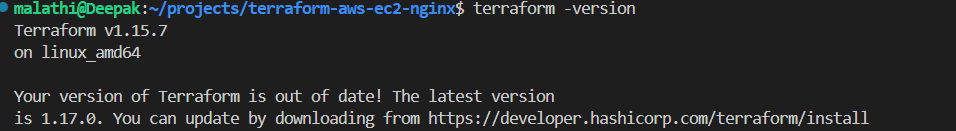

#### Step 1.3: Check AWS CLI installation

Command:

```bash
aws --version
```

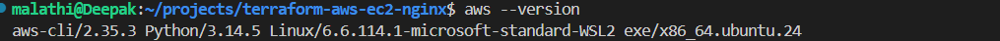

#### Step 1.4: Check the configured AWS Region

Command:

```bash
aws configure get region --profile ec2-nginx-lab
```

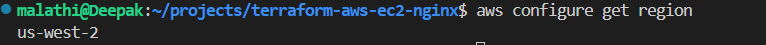

#### Step 1.5: Inspect the credential source safely

Check the configured credential source without printing secret access keys.

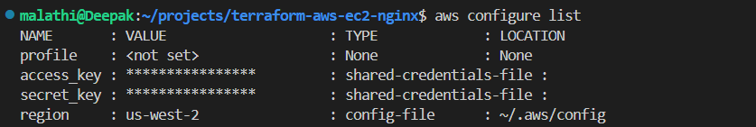

#### Step 1.6: List available AWS CLI profiles

Command:

```bash
aws configure list-profiles
```

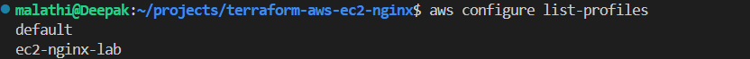

#### Step 1.7: Test the AWS profiles

Test whether the selected profile can authenticate with AWS.

Command:

```bash
aws sts get-caller-identity --profile ec2-nginx-lab
```

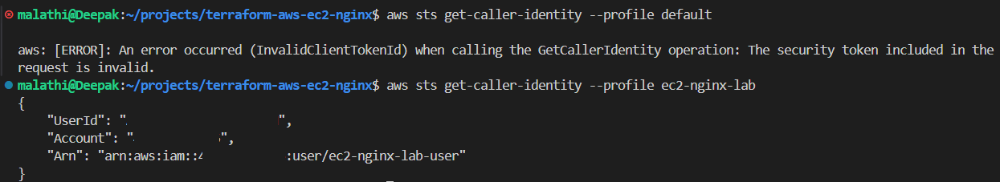

#### Step 1.8: Verify the working AWS profile

Confirm the identity associated with the profile.

Command:

```bash
aws sts get-caller-identity --profile ec2-nginx-lab
```

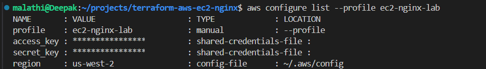

#### Step 1.9: Verify the Region

Command:

```bash
aws configure get region --profile ec2-nginx-lab
```

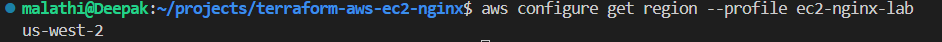

**Result:** Terraform and AWS CLI are installed, and the `ec2-nginx-lab` profile has been verified for AWS authentication.

### Phase 2: Discover Existing AWS Resources

Before provisioning infrastructure, inspect the existing AWS environment. This helps avoid unnecessary resources and prevents accidental changes to existing configurations.

#### Step 2.1: Check AWS permissions

Review the available permissions before creating resources.

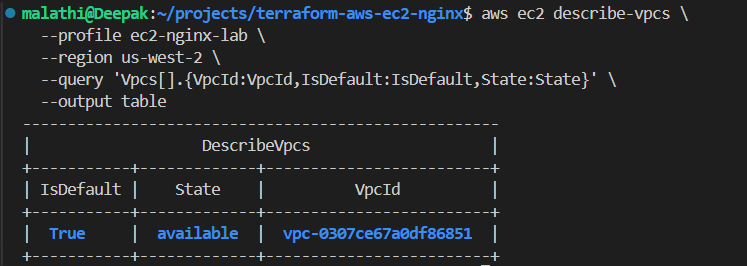

#### Step 2.2: Inspect existing subnets

Command:

```bash
aws ec2 describe-subnets \
  --profile ec2-nginx-lab \
  --region us-west-2 \
  --query 'Subnets[].{SubnetId:SubnetId,AZ:AvailabilityZone,CIDR:CidrBlock,Default:DefaultForAz}' \
  --output table
```

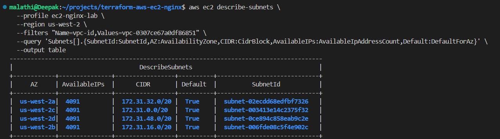

#### Step 2.3: Verify the Internet Gateway

Command:

```bash
aws ec2 describe-internet-gateways \
  --profile ec2-nginx-lab \
  --region us-west-2 \
  --query 'InternetGateways[].{GatewayId:InternetGatewayId,VPCs:Attachments[].VpcId}' \
  --output table
```

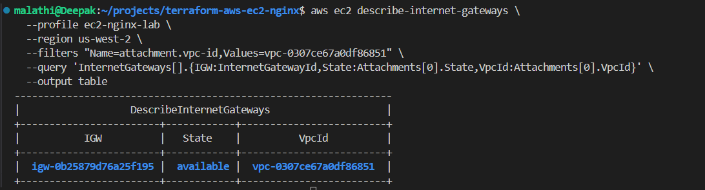

#### Step 2.4: Inspect the default route table

Command:

```bash
aws ec2 describe-route-tables \
  --profile ec2-nginx-lab \
  --region us-west-2 \
  --query 'RouteTables[].{RouteTableId:RouteTableId,VPC:VpcId,Routes:Routes[].{Destination:DestinationCidrBlock,Gateway:GatewayId}}' \
  --output json
```

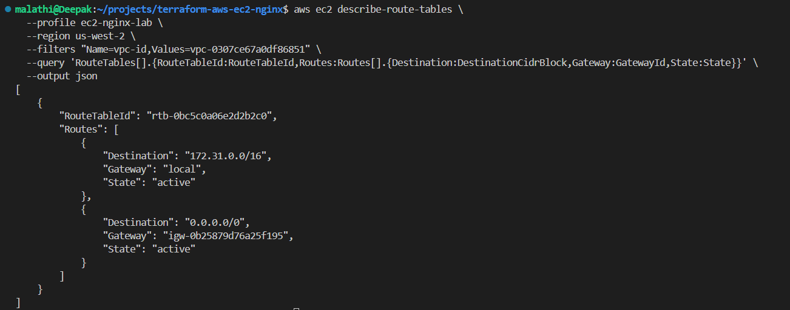

#### Step 2.5: Check EC2 permissions

Verify the permissions needed to inspect and manage EC2 resources.

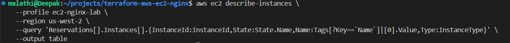

#### Step 2.6: Check security group permissions

Confirm the available permissions for security group operations.

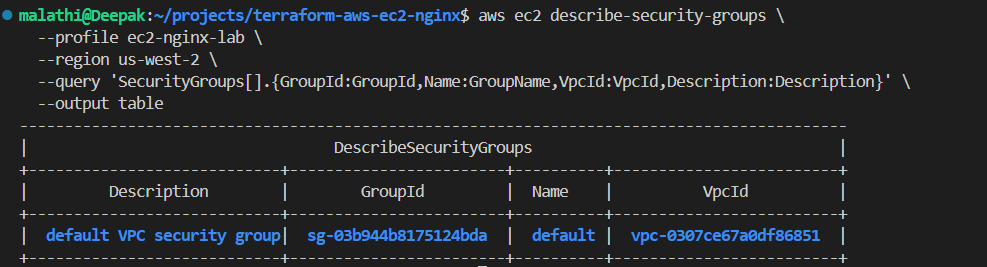

#### Step 2.7: Inspect existing security group rules

Command:

```bash
aws ec2 describe-security-groups \
  --profile ec2-nginx-lab \
  --region us-west-2 \
  --output table
```

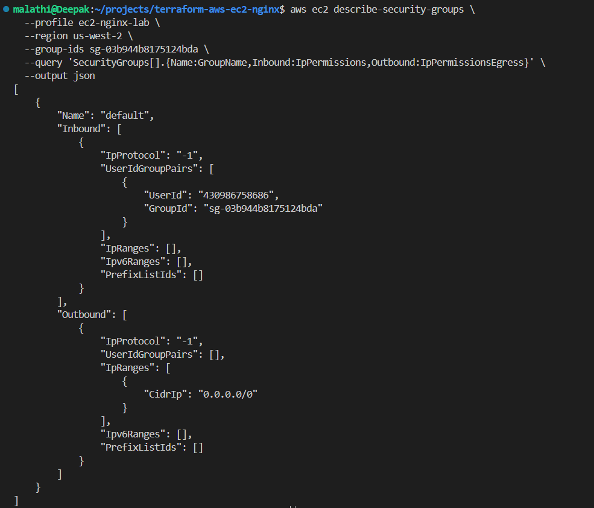

#### Step 2.8: Check existing EC2 key pairs

Command:

```bash
aws ec2 describe-key-pairs \
  --profile ec2-nginx-lab \
  --region us-west-2 \
  --output table
```

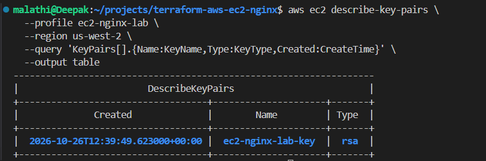

#### Step 2.9: Verify the local private key

Check that the existing private key file is available and has restrictive permissions.

Command:

```bash
ls -l ~/.ssh/ec2-nginx-lab-key.pem
```

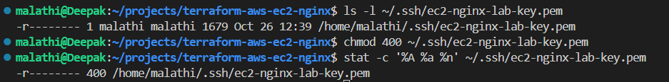

Never upload the private key to GitHub or include it in screenshots.

#### Step 2.10: Verify EC2 instance type availability

Check whether the intended instance type is offered in the selected Region and Availability Zone.

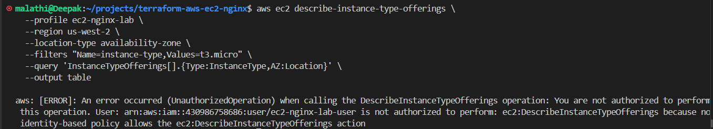

#### Step 2.11: Check access to IAM information

Some IAM inspection operations may be restricted for the lab user. Check permissions without assuming that the user can inspect every IAM setting.

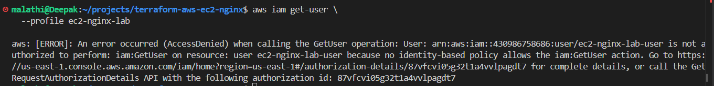

#### Step 2.12: Retest instance type discovery

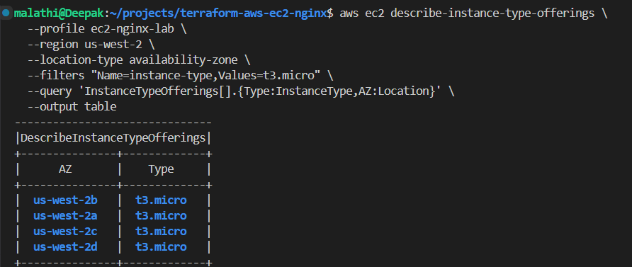

#### Step 2.13: Verify deployment permissions

Review the permissions needed to deploy the lab resources.

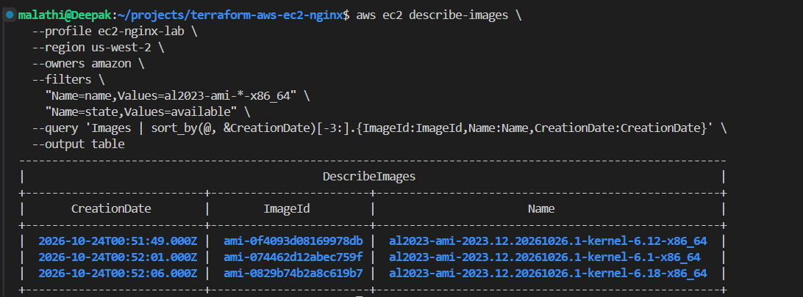

#### Step 2.14: Verify instance creation permissions

Check whether the configured IAM policy permits the required EC2 creation operations.

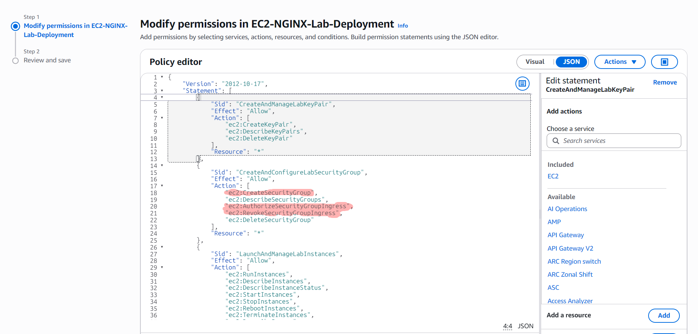

#### Step 2.15: Identify remaining permission gaps

Identify missing permissions before moving to resource creation.

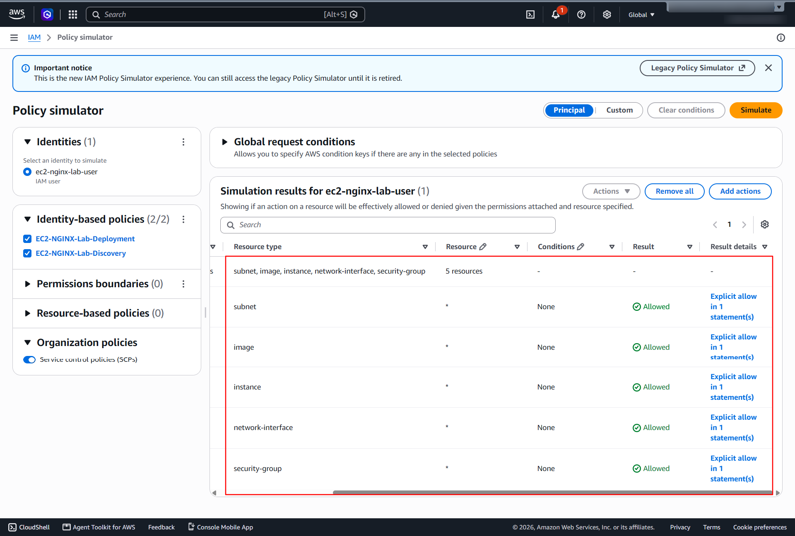

#### Step 2.16: Update the deployment policy

The deployment policy was updated to include `ec2:CreateTags`, which is commonly needed when Terraform creates or tags AWS resources.

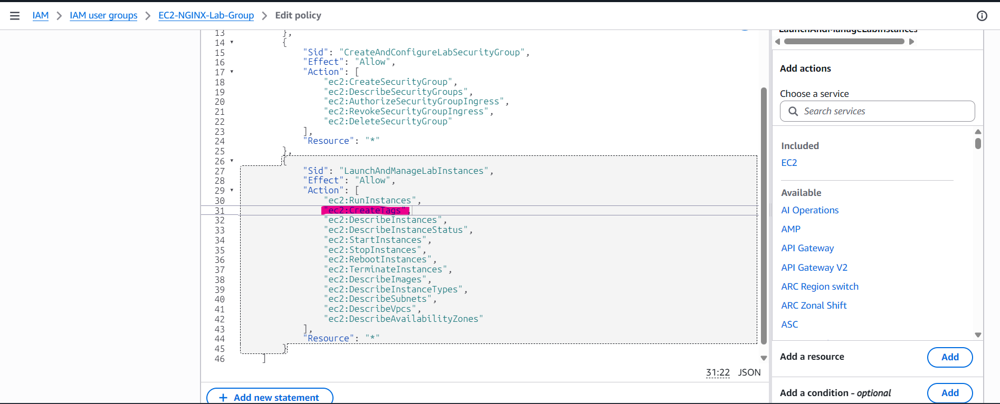

#### Step 2.17: Verify AWS credentials again

Command:

```bash
aws sts get-caller-identity --profile ec2-nginx-lab
```

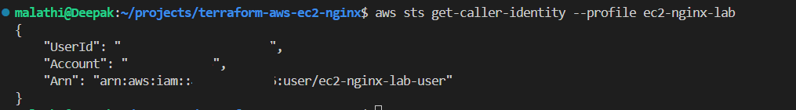

**Result:** The existing VPC, subnets, Internet Gateway, route table, key pair, and security group configuration have been inspected. The deployment policy has been updated. The existing default security group will not be modified; a dedicated security group should be created for this project.

### Phase 3: Configure Terraform

Terraform must use the intended AWS profile and Region.

#### Step 3.1: Configure the AWS provider

Create `versions.tf` with the following configuration:

```hcl
terraform {
  required_version = ">= 1.5.0"

  required_providers {
    aws = {
      source  = "hashicorp/aws"
      version = "~> 5.0"
    }
  }
}

provider "aws" {
  region  = "us-west-2"
  profile = "ec2-nginx-lab"
}
```

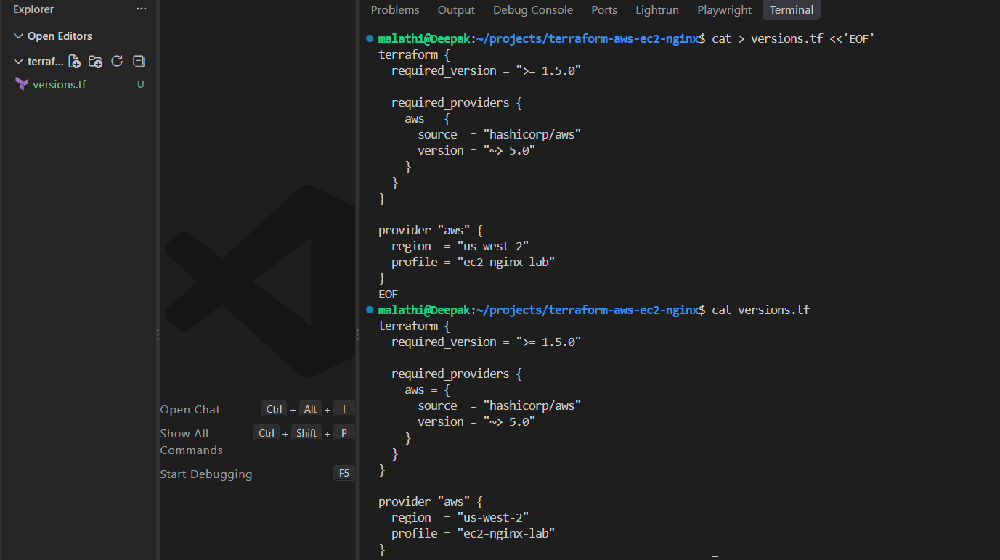

This configuration tells Terraform which AWS provider version to use and which profile and Region to select.

#### Step 3.2: Create a `.gitignore` file

Create `.gitignore` to prevent Terraform-generated files, local secrets, and state files from being committed.

Example:

```gitignore
# Terraform working directory
.terraform/

# Terraform state
*.tfstate
*.tfstate.*
crash.log
crash.*.log

# Variable files that may contain secrets
*.tfvars
*.tfvars.json

# Local override files
override.tf
override.tf.json
*_override.tf
*_override.tf.json

# Private keys and environment files
*.pem
*.key
.env
```

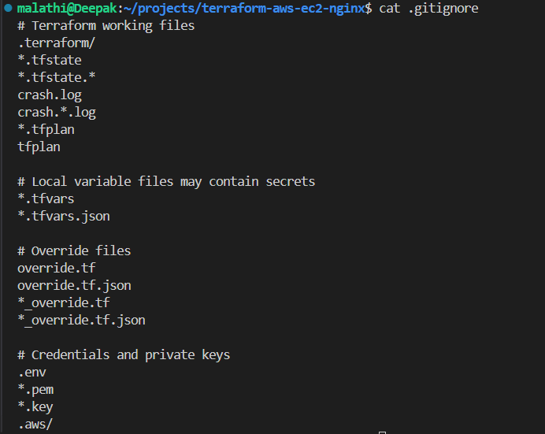

**Important:** `.gitignore` prevents new untracked files from being added accidentally, but it does not remove files that are already tracked by Git. Never commit AWS credentials, private keys, or sensitive Terraform state.

### Phase 4: Define the Infrastructure

This phase will define the AWS resources in Terraform files.

Planned files:

- `main.tf` — EC2 instance and dedicated security group configuration.
- `variables.tf` — configurable values such as instance type and allowed SSH source.
- `outputs.tf` — useful values such as the instance public IP and website URL.
- `user_data.sh` — startup script to install and start NGINX.

The configuration should use a current Amazon Linux 2023 AMI discovered from AWS rather than relying on an outdated hard-coded AMI ID.

**Status:** The infrastructure definition and resource deployment are still pending.

### Phase 5: Initialize and Validate Terraform

After the configuration files have been created, run the following commands in order.

Initialize Terraform:

```bash
terraform init
```

Check formatting:

```bash
terraform fmt -check
```

Validate the configuration:

```bash
terraform validate
```

Review the proposed changes:

```bash
terraform plan
```

Inspect the plan before applying it. Do not create resources until the planned instance, security group, network settings, and permissions have been reviewed.

### Phase 6: Deploy EC2 and NGINX

After the plan is reviewed and approved, deploy the resources:

```bash
terraform apply
```

Read the proposed actions and type `yes` only if they match the intended configuration.

The planned deployment should:

1. Create a dedicated security group.
2. Allow SSH only from an explicitly configured trusted source IP.
3. Allow HTTP traffic on port `80` for the web server.
4. Launch the EC2 instance in the selected VPC and subnet.
5. Install and start NGINX through the startup script.
6. Output the instance public IP and website URL.

Avoid opening SSH to `0.0.0.0/0`. Only permit HTTP from the internet if a publicly accessible demo website is intended.

### Phase 7: Verify the Deployment

After Terraform reports a successful deployment, verify the instance and web server.

Check Terraform outputs:

```bash
terraform output
```

Check the EC2 instance state:

```bash
aws ec2 describe-instances \
  --profile ec2-nginx-lab \
  --region us-west-2 \
  --query 'Reservations[].Instances[].{InstanceId:InstanceId,State:State.Name,PublicIP:PublicIpAddress}' \
  --output table
```

Open the website using the public IP or URL returned by Terraform:

```text
http://<EC2-PUBLIC-IP>
```

If the page does not load, check the instance state, security group inbound rules, subnet route, public IP assignment, and NGINX service logs before making changes.

### Phase 8: Clean Up Resources

When the lab is complete and you no longer need the infrastructure, review what Terraform plans to delete:

```bash
terraform plan -destroy
```

If the plan only includes the intended lab resources, run:

```bash
terraform destroy
```

Review the proposed actions and type `yes` to confirm.

Do not delete the existing VPC, shared network resources, or existing key pair unless you have explicitly decided they are no longer needed. The lab should only remove the resources managed for this project.

## 9. Advantages and Disadvantages

### Advantages

- Repeatable infrastructure provisioning.
- Version-controlled infrastructure configuration.
- Less manual work in the AWS Console.
- Easier review of planned changes before deployment.
- Practical experience with Terraform, AWS IAM, EC2, and NGINX.

### Disadvantages

- Incorrect permissions can block deployment.
- Misconfigured network rules can expose services.
- Terraform state must be protected.
- AWS resources can incur charges while running.
- A successful Terraform deployment does not automatically guarantee that the application is reachable.

## 10. Current Progress

Completed or checked:

- [x] Verified the local project directory.
- [x] Verified Terraform installation.
- [x] Verified AWS CLI installation.
- [x] Verified the working AWS CLI profile.
- [x] Confirmed the intended AWS Region.
- [x] Inspected existing VPC networking resources.
- [x] Inspected existing security group rules.
- [x] Verified the existing EC2 key pair and local private key.
- [x] Checked instance type availability.
- [x] Reviewed and updated the EC2 deployment permissions.
- [x] Prepared the initial Terraform provider configuration.
- [x] Prepared the `.gitignore` file.

Pending:

- [ ] Complete the Terraform configuration.
- [ ] Run Terraform initialization and validation.
- [ ] Review the Terraform plan.
- [ ] Create the dedicated security group and EC2 instance.
- [ ] Install and verify NGINX.
- [ ] Test the website in a browser.
- [ ] Capture deployment evidence.
- [ ] Clean up the lab resources when finished.

## 11. Conclusion

This project follows a cautious, step-by-step approach to AWS infrastructure automation. It begins with environment verification and permission checks before progressing to Terraform configuration and deployment.

The objective is not only to launch an EC2 instance, but also to understand how Terraform, AWS IAM, networking, security groups, and NGINX work together in a basic cloud deployment.

The project will be marked complete after the infrastructure is deployed, the NGINX website is verified, and the final evidence is documented.
